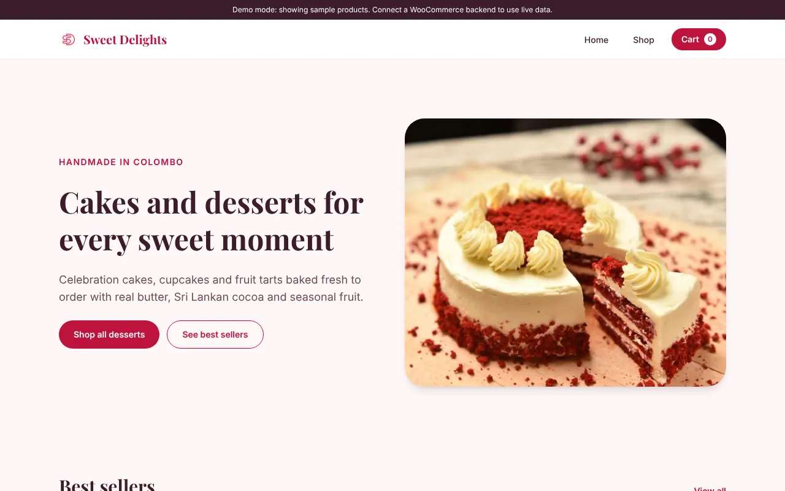
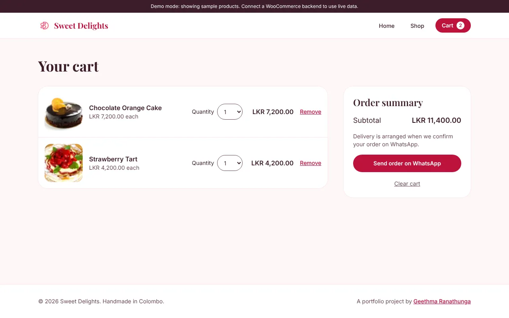
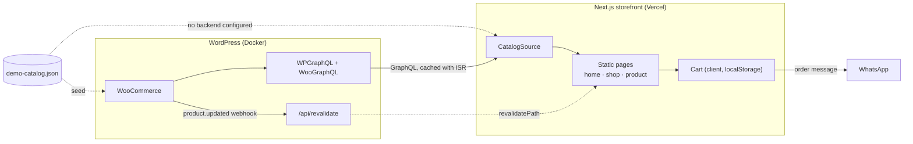

# Sweet Delights

**A headless WooCommerce storefront for a Colombo bakery, built with Next.js, TypeScript and GraphQL.**

[](https://github.com/Shani67/Sweet-Delights/actions/workflows/ci.yml)
[](https://sweet-delights-flame.vercel.app/)

WordPress and WooCommerce stay where editors are comfortable: managing products, prices and stock. Customers get a fast, statically generated Next.js storefront that reads the catalog over WPGraphQL, refreshes itself when products change, and passes automated WCAG 2.2 AA checks.

**[🍰 View the live demo](https://sweet-delights-flame.vercel.app/)** · Deployed on Vercel. The demo runs on the built-in catalog, so no WordPress server is needed to try it.

| Home                                     | Product                                        | Cart                                |
| ---------------------------------------- | ---------------------------------------------- | ----------------------------------- |
|  |  |  |

## Features

- **Headless WooCommerce** through WPGraphQL and WooGraphQL, behind a small `CatalogSource` interface
- **Static by default:** every product and category page is pre-rendered with `generateStaticParams` and refreshed by ISR
- **On-demand revalidation:** WooCommerce webhooks call `/api/revalidate`, so edits go live in seconds
- **Cart** that persists in `localStorage`, validated on load, with orders sent to the bakery on WhatsApp
- **Accessibility:** skip link, landmarks, live-region announcements, label-in-name, AA colour contrast, tested with axe on every page
- **Technical SEO:** per-page metadata and canonicals, `sitemap.xml`, `robots.txt`, and schema.org `Bakery`, `Product` and `BreadcrumbList`
- **Runs with zero setup:** without a backend the store uses a demo catalog, which is the same file used to seed WordPress

## Architecture



### Key decisions

| Decision                                                        | Why                                                                                        |
| --------------------------------------------------------------- | ------------------------------------------------------------------------------------------ |
| Pages depend on a `CatalogSource` interface, not on WooCommerce | The demo, tests and a future CMS can swap in without touching pages                        |
| One GraphQL request per render, shared between getters          | Avoids N+1 requests while building dozens of static pages                                  |
| Prices stored as integer cents                                  | No floating point rounding errors in totals                                                |
| CMS HTML converted to plain text                                | Content from WordPress can never inject markup or scripts                                  |
| `revalidatePath` webhook plus a time-based ISR fallback         | Fast updates when webhooks work, self-healing when they don't                              |
| WhatsApp ordering instead of online payment                     | Matches how many Sri Lankan bakeries take custom orders; online checkout is on the roadmap |

## Tech stack

Next.js 16 (App Router, React Server Components) · React 19 · TypeScript (strict) · Tailwind CSS 4 · WordPress 6.8 · WooCommerce · WPGraphQL · WooGraphQL · MariaDB · Docker Compose · Vitest · Testing Library · Playwright · axe-core · GitHub Actions · Vercel

## Getting started

Requires Node 22.

```bash
npm install
npm run dev          # http://localhost:3000, using demo data
```

### With a real WooCommerce backend

```bash
cd wordpress
docker compose up -d                 # WordPress on http://localhost:8080
docker compose run --rm setup        # installs plugins and imports the catalog
cd ..
cp .env.example .env.local           # set WORDPRESS_GRAPHQL_URL=http://localhost:8080/graphql
npm run dev
```

To have product edits revalidate the storefront, set the same `REVALIDATE_SECRET` in `.env.local` and when running `docker compose run --rm setup`. All settings are documented in [`.env.example`](.env.example).

## Quality checks

| Command             | What it runs                                                                                                              |
| ------------------- | ------------------------------------------------------------------------------------------------------------------------- |
| `npm run lint`      | ESLint with Next.js Core Web Vitals rules                                                                                 |
| `npm run typecheck` | TypeScript in strict mode                                                                                                 |
| `npm test`          | Vitest unit tests: cart logic, GraphQL mapping, price parsing, structured data                                            |
| `npm run test:e2e`  | Playwright on desktop and mobile: shopping journey, 404, SEO and axe scans of every page type (run `npm run build` first) |

GitHub Actions runs all of these on every pull request.

## Project structure

```
src/
  app/                  routes: home, shop, category, product, cart, sitemap, robots, api/revalidate
  components/           UI: product cards, cart, header, SEO helpers
  lib/catalog/          CatalogSource interface, WooGraphQL source, demo catalog
  lib/cart/             pure cart reducer and helpers
e2e/                    Playwright tests
wordpress/              Docker Compose backend and WP-CLI seed scripts
```

## Roadmap

- [ ] Online checkout through the WooCommerce Store API
- [ ] Sinhala and Tamil translations
- [ ] Product search and sorting
- [ ] Lighthouse CI performance budget

## Author

Built by **Geethma Ranathunga**, Senior Frontend / Full Stack Developer. [Portfolio](https://geethma-ranathunga.vercel.app) · [LinkedIn](https://linkedin.com/in/geethma-malshani)
